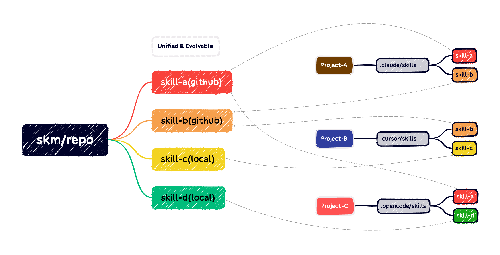

# Skills Management CLI (skm)

[简体中文](./README.zh-CN.md) | English

`skm` is a powerful CLI tool designed to manage and synchronize "skills" (prompt libraries, instruction sets, or capability modules) across various AI coding agents and projects. It serves as a central hub to add skills from GitHub or local directories and selectively link them into your local AI project configurations.

It supports the **Agent Skills open standard** (`<dir>/<name>/SKILL.md`) across 60+ AI coding agents, including **Claude Code**, **Codex**, **Gemini CLI**, **Cursor**, **OpenCode**, **GitHub Copilot**, **Antigravity**, **Windsurf**, **Kiro**, **Roo Code**, **Qwen Code**, **DeepSeek Harness (dsh)** and many more.

---

## 🚀 Features

- **Global Skill Repository**: Centralized management of your AI skills.
- **GitHub Integration**: Add skills directly from GitHub repositories or specific subdirectories (sparse checkout).
- **Local Skill Support**: Add skills from local directories for development and debugging.
- **Version Control**: Check for updates and synchronize changes from remote repositories.
- **Project Detection**: Automatically detects the AI project type in your current directory.
- **Project + User Scope**: Link skills into a project (`.claude/skills`) or into your home directory (`~/.claude/skills`) so they are available everywhere.
- **Shared Directory Awareness**: `.agents/skills` is read by ~20 agents at once; `skm` groups them into a single menu entry instead of spamming duplicates.
- **Symbolic Linking**: Efficiently links skills to projects without duplication, keeping them in sync.
- **Project Isolation**: Manage different sets of skills for different projects.



## 💡 Why skm?

- **Centralized Efficiency**: Skills are cloned only once (`~/.skills-management/repo`) and shared across infinite projects via symbolic links. This saves significant disk space and ensures all your projects use the same curated version of a skill.
- **Precision (Sparse Checkout)**: Only download what you need. If a GitHub repository contains hundreds of skills but you only want one, `skm` uses Git's sparse-checkout to download only that specific subdirectory. No more cloning massive repositories for a single prompt file.
- **Automatic Environment Awareness**: You don't need to know where Cursor, Claude, or OpenCode stores their skills. `skm` automatically detects your project environment and handles the directory structures for you.
- **Clean & Non-Intrusive**: Since skills are symlinked, your project folder stays clean. No extra `.git` folders or heavy files are added to your project's version control.
- **Self-healing**: Proactively detects and helps you clean up broken symbolic links if a global skill is deleted.
- **Version Sync**: Check for remote updates to keep your local "AI brain" sharp.

## 📦 Installation

This tool can be installed directly from npm:

```bash
npm install -g skills-management
```

Or install from source:

```bash
# Clone the repository
git clone https://github.com/nnnggel/skills-management.git
cd skills-management
npm install
npm run build
npm link
```

## 📖 Usage

Run the tool using `skm`:

```bash
skm
```

### 1. Global Repository Management (`repo`)

Select **"1. repo"** from the main menu to manage your global collection of skills.

#### Add Skill

**GitHub Type**:
- Full repositories: `https://github.com/user/repo` (example: https://github.com/blader/humanizer)
- Specific subfolders: `https://github.com/user/repo/tree/main/path/to/skill` (example: https://github.com/anthropics/skills/tree/main/skills/pdf)

**Local Type**:
- Local directories: `/local/path/to/skill` (example: `~/Desktop/myskill`)

#### Other Operations

- **Update Skills**: Checks for newer commits on the remote GitHub repository and updates your local copy (GitHub type only).
- **Delete Skills**: Remove skills from your global repository.

### 2. Project Skill Management (`list`)

Navigate to your AI project directory and run `skm`. The tool will detect the project type (e.g., `.opencode`, `.cursor`).

Select **"2. list(type)"** to manage skills for the current project.

- **Link/Unlink**: You will see a list of available global skills.
- **Checkbox Interface**: Use `Space` to select or deselect skills, and `Enter` to confirm.
- **Symlinks**: Selected skills are symlinked contents from your global repo into your project's skill directory (e.g., `.opencode/skills/`).

### Supported Agents

`skm` detects and installs skills into the following directories. The full, authoritative list is the `AGENTS` table in `src/core/agents.ts`; the rationale and sources live in [`directives/agents-skills-paths.md`](./directives/agents-skills-paths.md).

#### Shared `.agents/skills` group (one directory, many agents)

| Agents | Project | User (global) |
| --- | --- | --- |
| Codex, Gemini CLI, Cursor, GitHub Copilot, Cline, Zed, Warp, Kimi Code, Amp, Replit, Droid, Kilo, Deep Agents, Firebender, PromptScript, Universal, Loaf, fx, Dexto, Sarvam Code | `.agents/skills` | `~/.agents/skills` or `~/.config/agents/skills` |
| Antigravity, Antigravity CLI | `.agents/skills` | `~/.gemini/config/skills`, `~/.antigravity/skills` |

#### Dedicated directories

| Agent | Project | User (global) |
| --- | --- | --- |
| Claude Code | `.claude/skills` | `~/.claude/skills` (name `synced` reserved) |
| OpenCode | `.opencode/skills`, `.opencode/skill` | `~/.config/opencode/skills` |
| Pi | `.pi/skills`, `.agents/skills` | `~/.pi/agent/skills`, `~/.agents/skills` (`PI_CODING_AGENT_DIR` overrides the agent dir) |
| GitHub (legacy) | `.github/skills`, `.copilot/skills` | — |
| Windsurf | `.windsurf/skills` | `~/.codeium/windsurf/skills` |
| Kiro | `.kiro/skills` | `~/.kiro/skills` |
| Roo Code | `.roo/skills` | `~/.roo/skills` |
| Qwen Code | `.qwen/skills` | `~/.qwen/skills` |
| Trae / Trae CN | `.trae/skills` | `~/.trae/skills` / `~/.trae-cn/skills` |
| DeepSeek Harness (dsh) | `.dsh/skills` | `~/.dsh/skills` |
| CodeBuddy, Qoder, Qoder CN, Cursor, Continue, Crush, Goose, Augment, Junie, Zencoder, Tabnine CLI, Devin, ForgeCode, Grok, iFlow, Kode, Lingma, MiniMax, Mistral Vibe, Moxby, Mux, Neovate, Ona, OpenHands, Pochi, Posit Assistant, Reasonix, Rovo Dev, Terramind, Tinycloud, ZCode, IBM Bob, CodeArts, Codemaker, Code Studio, Command Code, Cortex, Hermes, inference.sh, Jazz, Kimchi, MCPJam, AiderDesk, AstrBot, Eve | see `src/core/agents.ts` | see `src/core/agents.ts` |

#### How detection works

- **Project scope**: for dot-directories (`.claude/skills`) the parent directory existing is enough to consider the agent installed. For non-hidden directories (`skills/`, `data/skills`) the directory itself must exist — otherwise every repository would match.
- **User scope**: an agent shows up when its config directory exists (`~/.claude`, `~/.codex`, `~/.dsh`, ...) or when the skills directory itself already exists. Only detected agents appear in the menu.
- **Deduplication**: directories are grouped by resolved absolute path. `.agents/skills` produces one entry whose label lists the clients that share it.
- **One directory per agent**: if an agent accepts several locations, the first match wins.
- **Global dirs are exclusive**: a directory that is some agent's user-level skill dir (`~/.dsh/skills`, `~/.claude/skills`) is never offered as a project target — so running `skm` inside `~/.dsh` only shows the global entry.
- **Project dirs must be namespaced**: auto-detection only accepts hidden dirs (`.claude/skills`) or vendor-prefixed dirs (`data/skills`). A bare `skills/` at the repository root is too generic and is not auto-detected (OpenClaw users can add `{"type":"openclaw","skillDirs":["skills"]}` to `aiTools`).

#### Menu context

The menu only shows what makes sense where you are:

| Where you run `skm` | What the menu lists |
| --- | --- |
| Inside an agent config dir (`~/.dsh`, `~/.claude`, `~/.pi/agent`, or any subdirectory) | Only that agent's user-level dir (`~/.dsh/skills`), even if it does not exist yet |
| Inside a project (a detected `.claude/`, `.dsh/`, `.agents/`, ... exists) | Only the project-level dirs (several may be listed) |
| Anywhere else (`~`, `~/Desktop`, an empty dir) | Every user-level dir; the home directory itself is never treated as a project root |

When the menu is filtered, a `list(all)` entry is appended so you can still reach every agent and scope in one session.

#### Known limitations

- **Linked folder names carry the source prefix** (`github__user__repo__path`, `local__myskill`). This keeps multiple same-named skills side by side on disk and preserves provenance, but it violates the “`name` must match the parent directory” rule. Claude Code and Gemini CLI are unaffected; OpenCode loads it but exposes the folder name as the skill id; **VS Code / GitHub Copilot will not load it** (“If the name does not match, the skill is not loaded.”).
- **Symlink support in VS Code is unverified** (its documentation does not mention symlinks).
- Global scope is limited to agents `skm` detects as installed; it will not create config directories for tools you do not use.

#### Custom AI Tools Configuration

You can customize the AI tools detection by adding `aiTools` to your `~/.skills-management/config.json`:

```json
{
  "system": "darwin",
  "aiTools": [
    { "type": "cursor", "skillDirs": [".cursor/skills"] },
    {
      "type": "custom-ai",
      "skillDirs": [".custom-ai/skills", ".custom-ai/prompts"],
      "globalSkillDirs": ["~/.custom-ai/skills"],
      "detectGlobal": ["~/.custom-ai"],
      "reservedNames": []
    }
  ]
}
```

Each entry requires:
- **`type`**: A unique identifier for the AI tool (used in menu display)
- **`skillDirs`**: An array of possible skill directory paths (relative to project root)

Optional fields:
- **`globalSkillDirs`**: User-level skill directories (`~/...`), enables `list(... · global)` entries
- **`detectGlobal`**: Paths used to decide whether the tool is installed (derived from `globalSkillDirs` when omitted)
- **`reservedNames`**: Folder names `skm` must never write or delete (e.g. Claude Code's `synced`)

> **Note**: When `aiTools` is configured, it completely replaces the default configuration. If you want to keep some defaults, include them in your custom configuration.

---

## 🏗️ Directory Structure & Internals

`skm` stores its global data and configuration in your home directory at `~/.skills-management`. This architecture ensures that skills are downloaded once and shared across multiple projects.

### Data Layout:

- **`config.json`**: Global configuration file. It stores system-level settings and metadata.
- **`repo/`**: The heart of the management system.
    - **`skills.json`**: The skill registry. It tracks all added skills, their unique IDs, current commit hashes (for version control), and original paths.
    - **`[type]__[name]/`**: Local skill repository storage. `skm` flattens the ID (replacing `/` with `__`) to create safe directory names. For example, `github:user/repo/path` becomes `github__user__repo__path`, and `local:myskill` becomes `local__myskill`.
    - **Note**: `skm` handles complex paths like `github:user/repo/path/to/skill` by creating a unique folder like `github__user__repo__path__to__skill`.

### Cross-Platform Compatibility (Windows)
`skm` is fully compatible with Windows.
- On **macOS/Linux**, it uses standard symbolic links.
- On **Windows**, it automatically uses **Directory Junctions** (a type of symbolic link for folders) to ensure capability without requiring Administrator privileges or Developer Mode.


## 📝 Changelog

### v1.1.0
- Full Agent Skills coverage: 60+ agents (Claude Code, Codex, Gemini CLI, Cursor, OpenCode, GitHub Copilot, Antigravity, Windsurf, Kiro, Roo Code, Qwen Code, DeepSeek Harness and more)
- User-level (global) scope: link skills into `~/.claude/skills`, `~/.agents/skills`, `~/.dsh/skills`, ...
- Shared-directory deduplication: `.agents/skills` is one menu entry that lists every client reading it
- Fixes: outdated Antigravity paths removed; non-hidden directories (`skills/`) no longer match every repository
- Safety: reserved names (Claude Code's `synced`) are never written or deleted; broken-symlink cleanup defaults to *no* for user scope

### v1.0.5
- Display version number in main menu
- Show non-skm managed skills when managing project skills
- Support custom AI tools configuration via `config.json`

### v1.0.4
- Adjusted AI tool detection directories to match official configurations

### v1.0.3
- Local Skill Support: Add skills directly from local directories
- Menu Navigation Optimization: Unified numeric menu style, added return options, improved terminal compatibility

## 📄 License

ISC
