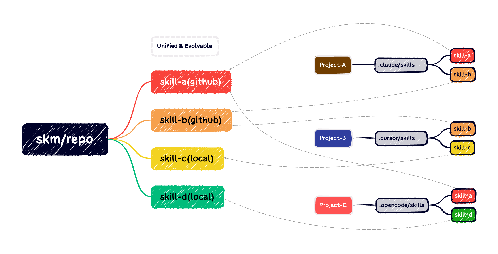

# Skills Management CLI (skm)

简体中文 | [English](./README.md)

`skm` 是一个强大的命令行工具，用于在各种 AI 编程代理和项目中管理与同步“技能”（Skills，即提示词库、指令集或能力模块）。它作为一个中心枢纽，帮助你从 GitHub 或本地目录添加技能，并将其选择性地链接到本地 AI 项目配置中。

遵循 **Agent Skills 开放规范**（`<dir>/<name>/SKILL.md`），支持 60+ 个 AI 编程客户端，包括 **Claude Code**、**Codex**、**Gemini CLI**、**Cursor**、**OpenCode**、**GitHub Copilot**、**Antigravity**、**Windsurf**、**Kiro**、**Roo Code**、**Qwen Code**、**DeepSeek Harness (dsh)** 等。

---

## 🚀 功能特性

- **全局技能仓库**：集中管理所有的 AI 技能。
- **GitHub 集成**：直接从 GitHub 仓库或指定子目录添加技能（支持稀疏检出）。
- **本地技能支持**：支持从本地目录添加技能，方便开发和调试。
- **版本控制**：检查远程更新并同步技能版本。
- **项目检测**：自动检测当前目录下的 AI 项目类型。
- **项目级 + 用户级双作用域**：既可链接进项目（`.claude/skills`），也可链接进用户主目录（`~/.claude/skills`），一次安装全机可用。
- **共享目录归并**：`.agents/skills` 会被约 20 个客户端读取，`skm` 将其合并为一个菜单项并标注共用者，不再刷屏。
- **软链接管理**：通过符号链接将技能高效注入项目，避免文件复制，保持同步。
- **项目隔离**：为不同项目配置不同的技能组合。



## 💡 为什么选择 skm?

- **核心效率**：技能仅克隆一次（存储在 `~/.skills-management/repo`），通过符号链接在无限个项目间共享。这不仅极大地节省了磁盘空间，还确保了所有项目使用的技能版本高度统一。
- **精准下载 (稀疏检出)**：只下载你需要的。如果一个 GitHub 仓库包含几百个技能，而你只需要其中一个，`skm` 会利用 Git 的 `sparse-checkout` 特性仅下载特定的子目录。告别为了一个几 KB 的 Prompt 而克隆整个几百 MB 仓库的时代。
- **自动化环境感知**：你不需要记住 Cursor、Claude 或 OpenCode 把技能存在哪里。`skm` 会自动识别你的项目环境并处理对应的目录结构。
- **整洁且无侵入**：由于使用的是软链接，你的项目文件夹保持纯净。不会有额外的 `.git` 文件夹或庞大的二进制文件进入你的项目版本控制。
- **自我维护**：主动检测并帮助你清理失效的软链接（例如当全局技能被删除时）。
- **版本同步**：检查技能的远程更新，确保你的“AI 大脑”始终处于最新状态。

## 📦 安装指南

可以直接从 npm 安装：

```bash
npm install -g skills-management
```

或者从源码安装：

```bash
# 克隆仓库
git clone https://github.com/nnnggel/skills-management.git
cd skills-management

# 安装依赖并构建
npm install
npm run build
npm link
```

## 📖 使用指南

直接运行命令 `skm`：

```bash
skm
```

### 1. 全局仓库管理 (`repo`)

在主菜单选择 **"1. repo"** 来管理你的全局技能库。

#### 添加技能 (Add skill)

**GitHub 类型**：
- 支持完整仓库：`https://github.com/user/repo` (例子：https://github.com/blader/humanizer)
- 支持特定子目录：`https://github.com/user/repo/tree/main/path/to/skill` (例子：https://github.com/anthropics/skills/tree/main/skills/pdf)

**Local 类型**：
- 支持本地目录：`/local/path/to/skill` (例子：`~/Desktop/myskill`)

#### 其他操作

- **更新技能 (Update)**：自动检查远程仓库是否有新提交，并更新本地副本（仅支持 GitHub 类型）。
- **删除技能 (Delete)**：从全局仓库中移除技能。

### 2. 项目技能管理 (`list`)

在你的 AI 项目根目录下运行 `skm`。工具会自动识别项目类型（如 `.opencode`, `.cursor` 等）。

选择 **"2. list(type)"** 来管理当前项目的技能。

- **链接/取消链接 (Link/Unlink)**：显示全局可用技能列表。
- **复选框交互**：使用 `空格键` 选中或取消选中技能，`回车键` 确认。
- **自动注入**：选中的技能会以软链接形式注入到项目的技能目录中（例如 `.opencode/skills/`）。

### 支持的客户端与目录

`skm` 识别并安装到以下目录。唯一权威清单是 `src/core/agents.ts` 中的 `AGENTS` 表，路径依据与来源见 [`directives/agents-skills-paths.md`](./directives/agents-skills-paths.md)。

#### 共享 `.agents/skills` 组（一个目录，多家客户端共读）

| 客户端 | 项目级 | 用户级（global） |
| --- | --- | --- |
| Codex、Gemini CLI、Cursor、GitHub Copilot、Cline、Zed、Warp、Kimi Code、Amp、Replit、Droid、Kilo、Deep Agents、Firebender、PromptScript、Universal、Loaf、fx、Dexto、Sarvam Code | `.agents/skills` | `~/.agents/skills` 或 `~/.config/agents/skills` |
| Antigravity、Antigravity CLI | `.agents/skills` | `~/.gemini/config/skills`、`~/.antigravity/skills` |

#### 自有目录

| 客户端 | 项目级 | 用户级（global） |
| --- | --- | --- |
| Claude Code | `.claude/skills` | `~/.claude/skills`（`synced` 为保留名） |
| OpenCode | `.opencode/skills`、`.opencode/skill` | `~/.config/opencode/skills` |
| Pi | `.pi/skills`、`.agents/skills` | `~/.pi/agent/skills`、`~/.agents/skills`（`PI_CODING_AGENT_DIR` 可改 agent 目录） |
| GitHub（legacy） | `.github/skills`、`.copilot/skills` | — |
| Windsurf | `.windsurf/skills` | `~/.codeium/windsurf/skills` |
| Kiro | `.kiro/skills` | `~/.kiro/skills` |
| Roo Code | `.roo/skills` | `~/.roo/skills` |
| Qwen Code | `.qwen/skills` | `~/.qwen/skills` |
| Trae / Trae CN | `.trae/skills` | `~/.trae/skills` / `~/.trae-cn/skills` |
| DeepSeek Harness (dsh) | `.dsh/skills` | `~/.dsh/skills` |
| CodeBuddy、Qoder、Continue、Crush、Goose、Augment、Junie、Zencoder、Tabnine CLI、Devin、ForgeCode、Grok、iFlow、Kode、Lingma、MiniMax、Mistral Vibe、Moxby、Mux、Neovate、Ona、OpenHands、Pochi、Posit Assistant、Reasonix、Rovo Dev、Terramind、Tinycloud、ZCode、IBM Bob、CodeArts、Codemaker、Code Studio、Command Code、Cortex、Hermes、inference.sh、Jazz、Kimchi、MCPJam、AiderDesk、AstrBot、Eve | 见 `src/core/agents.ts` | 见 `src/core/agents.ts` |

#### 检测规则

- **项目级**：隐藏目录（`.claude/skills`）只要父目录存在就视为已安装；非隐藏目录（`skills/`、`data/skills`）必须目录本身存在，否则任何仓库都会被误判。
- **用户级**：客户端配置目录存在（`~/.claude`、`~/.codex`、`~/.dsh` 等）或 skills 目录本身存在时才出现；菜单只列出检测到已安装的客户端。
- **去重**：按解析后的绝对路径分组，`.agents/skills` 只出现一次，标签里列出共用它的客户端。
- **一个客户端一条**：同一客户端接受多个目录时，第一个命中的优先。
- **用户级目录独占**：某个 agent 的用户级目录（`~/.dsh/skills`、`~/.claude/skills`）绝不会再作为项目级目标出现——所以在 `~/.dsh` 里跑 `skm` 只会看到 global 那一项。
- **项目级目录必须带命名空间**：自动探测只认隐藏目录（`.claude/skills`）或 vendor 前缀目录（`data/skills`）。仓库根的裸 `skills/` 太通用，不做自动探测（OpenClaw 用户可在 `aiTools` 里加 `{"type":"openclaw","skillDirs":["skills"]}`）。

#### 菜单上下文收敛

菜单只显示当前目录下有意义的目标：

| 你在哪运行 `skm` | 菜单列出 |
| --- | --- |
| 某个 agent 的配置目录内（`~/.dsh`、`~/.claude`、`~/.pi/agent` 或其子目录） | 只列该 agent 的用户级目录（`~/.dsh/skills`），目录还不存在也会列出 |
| 项目内（检测到 `.claude/`、`.dsh/`、`.agents/` 等） | 只列项目级目录（可能有多个） |
| 其他位置（`~`、`~/Desktop`、空目录） | 列出全部用户级目录；home 目录本身永远不会被当作项目根 |

被收敛时会额外追加一项 `list(all)`，让你在一次会话里仍能访问所有 agent 与作用域。

#### 已知限制

- **软链接目录名带来源前缀**（`github__user__repo__path`、`local__myskill`）。这让同名技能可以在磁盘上并存并保留来源信息，但与规范「`name` 必须等于父目录名」不一致：Claude Code、Gemini CLI 不受影响；OpenCode 能加载但会把目录名当作 skill id；**VS Code / GitHub Copilot 不会加载**（官方原文：“If the name does not match, the skill is not loaded.”）。
- **VS Code 是否跟随符号链接尚未验证**（其官方文档未提及 symlink）。
- global 作用域只对 `skm` 检测到已安装的客户端开放，不会替你创建未使用工具的配置目录。

#### 自定义 AI 工具配置

你可以通过在 `~/.skills-management/config.json` 中添加 `aiTools` 来自定义 AI 工具检测：

```json
{
  "system": "darwin",
  "aiTools": [
    { "type": "cursor", "skillDirs": [".cursor/skills"] },
    {
      "type": "custom-ai",
      "skillDirs": [".custom-ai/skills", ".custom-ai/prompts"],
      "globalSkillDirs": ["~/.custom-ai/skills"],
      "detectGlobal": ["~/.custom-ai"],
      "reservedNames": []
    }
  ]
}
```

每个条目需要：
- **`type`**: AI 工具的唯一标识符（在菜单中显示）
- **`skillDirs`**: 可能的技能目录路径数组（相对于项目根目录）

可选字段：
- **`globalSkillDirs`**: 用户级技能目录（`~/...` 形式），用于生成 `list(... · global)` 菜单项
- **`detectGlobal`**: 判断该工具是否安装的探测路径（缺省由 `globalSkillDirs` 推导）
- **`reservedNames`**: `skm` 绝不能写入或删除的目录名（例如 Claude Code 的 `synced`）

> **注意**: 配置 `aiTools` 后会完全替换默认配置。如果需要保留部分默认配置，请将它们包含在自定义配置中。

---

## 🏗️ 目录结构与运行机制

`skm` 将所有的全局数据和配置存储在用户主目录下的 `~/.skills-management` 文件夹中。这种设计确保了技能只需下载一次，即可在多个项目间共享。

### 内部结构：

- **`config.json`**: 全局配置文件，存储系统级设置和元数据。
- **`repo/`**: 管理系统的核心目录。
    - **`skills.json`**: 技能注册表（数据库）。记录了所有已添加技能的 ID、当前 Commit Hash（用于版本追踪）、检出类型和路径信息。
    - **`[type]__[name]/`**: 本地 Skill 仓库存储中心。`skm` 会将 ID 扁平化（将 `/` 替换为 `__`）以创建安全的文件目录名。例如 `github:user/repo/path` 会被存储为 `github__user__repo__path`，`local:myskill` 会被存储为 `local__myskill`。

### Windows 兼容性说明
`skm` 完全兼容 Windows 系统。
- 在 **macOS/Linux** 上，使用标准的符号链接 (Symbolic Links)。
- 在 **Windows** 上，工具会自动使用 **Directory Junctions** (目录联接点)。这是 Windows NTFS 文件系统的一种特性，类似于目录的软链接，但通常**不需要管理员权限**即可创建，确保了最佳的开箱即用体验。

---

## 📝 更新日志

### v1.1.0
- 全量 Agent Skills 覆盖：60+ 客户端（Claude Code、Codex、Gemini CLI、Cursor、OpenCode、GitHub Copilot、Antigravity、Windsurf、Kiro、Roo Code、Qwen Code、DeepSeek Harness 等）
- 新增用户级（global）作用域：可安装到 `~/.claude/skills`、`~/.agents/skills`、`~/.dsh/skills` 等
- 共享目录归并：`.agents/skills` 只占一个菜单项，并列出所有共读它的客户端
- 修正：移除过时的 Antigravity 路径；非隐藏目录（`skills/`）不再匹配任意仓库
- 安全：保留名（Claude Code 的 `synced`）不会被写入或删除；用户级作用域的失效软链清理默认不执行

### v1.0.5
- 主菜单显示版本号
- 项目技能管理时显示非 skm 管理的 skills
- 支持用户在 `config.json` 中自定义（覆盖）AI 工具路径

### v1.0.4
- 调整了识别 AI 工具的目录，与官方配置保持一致

### v1.0.3
- 支持本地技能 (Local Skill)：可以直接从本地目录添加技能
- 菜单引导优化：统一使用数字菜单，添加返回选项，提升终端兼容性

## 📄 License

ISC
